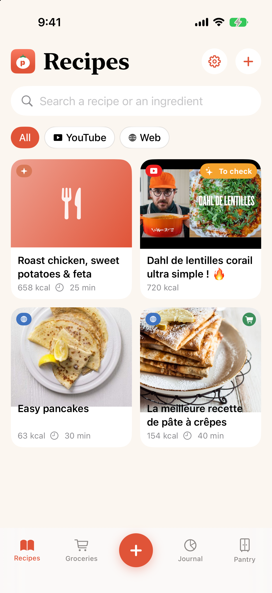
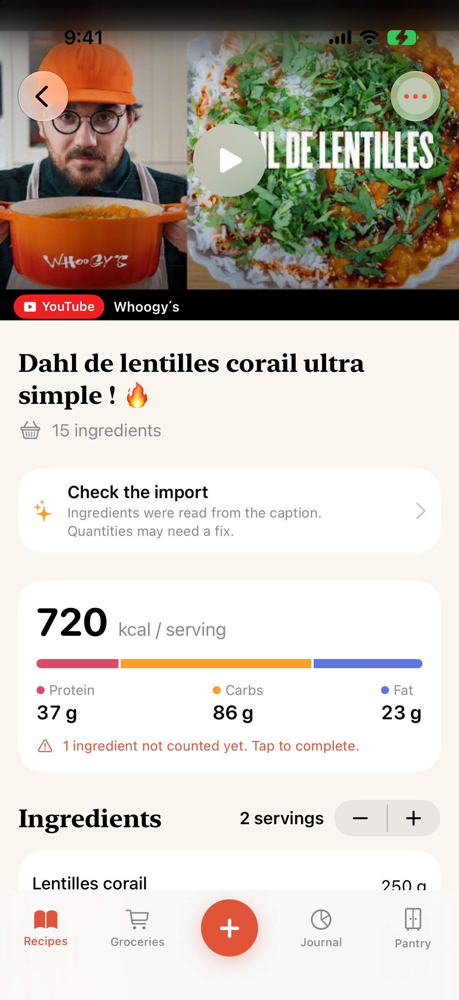
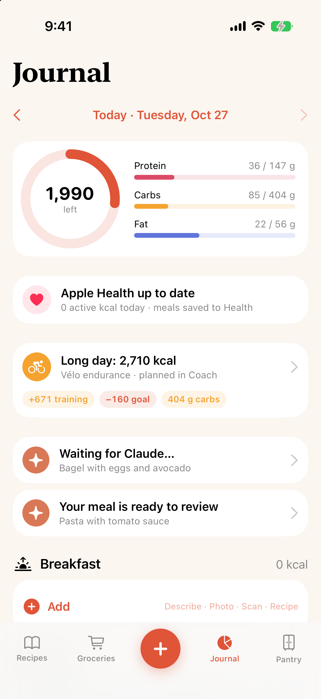
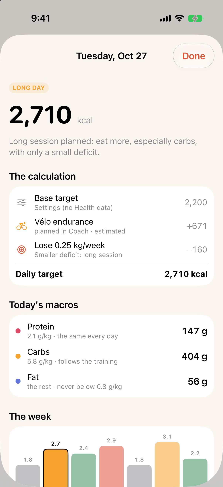

# Popote

A personal food app for iPhone. Share a recipe from Instagram, YouTube, TikTok or any website and Popote pulls out the ingredients, steps, picture and video. It counts calories and macros ingredient by ingredient, builds the shopping list and syncs it to Bring!, and keeps a food journal that goes to Apple Health.

<p>
  
  
  
  
</p>

The UI is in English and French and follows the iPhone's language. The screens were designed in [UI Studio](https://github.com/LeoBrunet/UIStudio). It works on its own, and pairs with [Coach](https://github.com/LeoBrunet/Coach): with both on the iPhone, each day's calorie and carb targets follow your training plan.

## What it does

- **Import from a link.** The share extension saves the link to an App Group inbox and closes. The app imports it the next time it comes to the foreground, or right away when you paste a link with the + button.
  - Recipe sites: `schema.org/Recipe` JSON-LD (Marmiton, BBC Good Food, NYT Cooking…).
  - YouTube: oEmbed for the title, then the description from the Data API if you set a key in Settings, otherwise from the watch page. Steps with timestamps jump the embedded player to that point.
  - TikTok: oEmbed, falling back to the video page for the caption. The video is embedded with TikTok's player.
  - Instagram: the public post page, read as a link-preview crawler, falling back to the embed page. The post is embedded.
  - Captions are turned into ingredients and steps by Apple's on-device model (iOS 26 with Apple Intelligence on) or by built-in rules. Imported recipes are flagged "Check the import" until you save them.
- **Macros.** Every ingredient line is parsed into quantity, unit and name, in French or English ("2 c. à soupe de miso", "1 ½ cups flour", "Farine : 200 g"). It is then matched to a built-in table of about 170 common foods (Ciqual/USDA values per 100 g, unit weights, densities) and converted to grams. Tap an ingredient to pick another food, a product from Open Food Facts (search or barcode scan), set its weight, or leave it out.
- **Groceries.** Quantities from every recipe in the list are added up, scaled to the servings you pick and sorted by aisle. Items in your pantry are set aside and salt, pepper and water are left off. You can share the list as text or sync it with Bring!.
- **Bring!** Uses the same private API as Bring!'s web app, straight from the phone, with your password kept in the Keychain. It reads your list, shows what will be added, what gets a new quantity ("1 → 4") and what's already there, then sends everything in one update. It never removes anything. Catalog items are matched through Bring!'s translation file ("Citron" ↔ "Zitrone").
- **Journal.** Log a serving of a recipe, a scanned product or a food by weight. Each entry is saved to Apple Health as a food correlation (kcal, protein, carbs, fat) and deleting the entry deletes it from Health too. The daily target follows your goal and, if Coach is installed, your training plan (see [Daily targets](#daily-targets)).
- **Claude.** Same setup as the Coach app: no API key. Claude runs in the Claude app on your own plan, through Popote's MCP connector (`server/`). The + button lets you describe a meal or photograph your plate: Popote sends it to the server and opens Claude, which reads it (`get_meal_request`) and saves the ingredients (`save_meal_analysis`); back in Popote you review them, then log the meal and/or save it as a recipe. On Recettes, + › Create with Claude opens Claude with your request; Claude can read your pantry and remaining targets (`get_context`) and adds the recipe with `save_recipe`. One-time setup: Settings › Claude › Connector.
- **Pantry.** What you have at home: left off the shopping list, and used to suggest recipes you can cook tonight.

## Running it

Requires Xcode 26 or later. It targets iOS 17+, and the on-device model needs iOS 26.

```bash
./run.sh          # build and launch in the booted simulator ("iPhone 17 Pro" by default)
./run.sh build    # build only
```

To import a link in the simulator without the share sheet:

```bash
xcrun simctl openurl booted "popote://import?url=https%3A%2F%2Fwww.marmiton.org%2Frecettes%2Frecette_pate-a-crepes_12372.aspx"
```

To see the app in French: `xcrun simctl launch booted com.leobrunet.popote -AppleLanguages "(fr)"`.

**On a real iPhone**, pick your own team under Signing & Capabilities for both targets (Popote and PopoteShare), and change the bundle IDs and App Groups (`group.com.leobrunet.popote` for both targets, `group.com.leobrunet.shared` for the app, shared with Coach) to ones your team can register.

## Server

```bash
cd server
npm install
DATABASE_PATH=./dev.db npm run dev        # http://localhost:8788
npm test                                  # app ↔ server ↔ MCP loop
npx tsx scripts/play-claude.ts "<connector URL>" meal     # plays Claude locally (Claude can't reach localhost)
npx tsx scripts/play-claude.ts "<connector URL>" recipe
```

Deployed on Cloudflare (Workers + D1, free plan): https://popote-server.leobrunet91-39d.workers.dev — the app uses it by default (`POPOTE_SERVER_URL` in the build settings). To redeploy: `npx wrangler deploy` (wrangler needs Node ≥ 20). To work against the local server, set `http://localhost:8788` in Settings › Claude › Server.

## Layout

```
Popote/            app target
  App/             entry point, root view with the tab bar
  Import/          link → recipe: extractors per source, JSON-LD, caption structuring, ingredient parser
  Nutrition/       food table, unit conversions, matching, Open Food Facts, barcode scanner
  Shopping/        merged shopping list, Bring! client and merge
  Claude/          Popote server client, Claude handoff links, sync of meals and recipes
  Health/          HealthKit read/write (meals, energy, workouts, weight)
  Targets/         daily target engine, Coach plan reader, goal settings, weekly learning
  Features/        screens (Library, Recipe, Grocery, Journal, Targets, Pantry, Settings)
  Theme/           colours, logo, shared components
PopoteShare/       share extension
Shared/            code and strings used by both targets (inbox, Localizable.xcstrings)
server/            REST API for the app + MCP connector for Claude (Node + SQLite locally, Cloudflare Workers + D1)
```

Strings are written in English in the code. French lives in `Shared/Localizable.xcstrings`, and permission prompts in `Popote/InfoPlist.xcstrings`. When you add a string, add its French translation to the catalog.

## Known limits

- The Bring! sync relies on a private API and has not been tested against a real account yet. A Bring! update can break it; sharing the list as text always works.
- Instagram and TikTok pages change often. When a caption can't be read, paste it into "Check the recipe" › Caption.
- The food table covers common ingredients only. Anything else is "To complete" until you match it, or scan or search the product.
- YouTube descriptions without a Data API key depend on the watch page, which can show a consent wall.

## Daily targets

Each day's kcal/macro target = resting energy + everyday movement (Health) + training + learned correction ± goal (Settings › Goal).
Training comes from the Coach app's plan, shared on the phone through the App Group `group.com.leobrunet.shared` (`coach-plan.json`, written by Coach's `PlanShare`): estimated from the session's zones until the real Health workout replaces it.
A weight-loss deficit is spread over the week (more on rest days, less on long days, none on key sessions or in race week); every week `MaintenanceLearner` compares the weight trend with logged intake and adjusts a correction. Code in `Popote/Targets/` and `Popote/Features/Targets/`.

